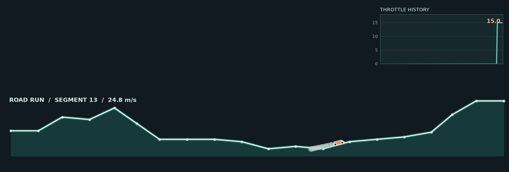
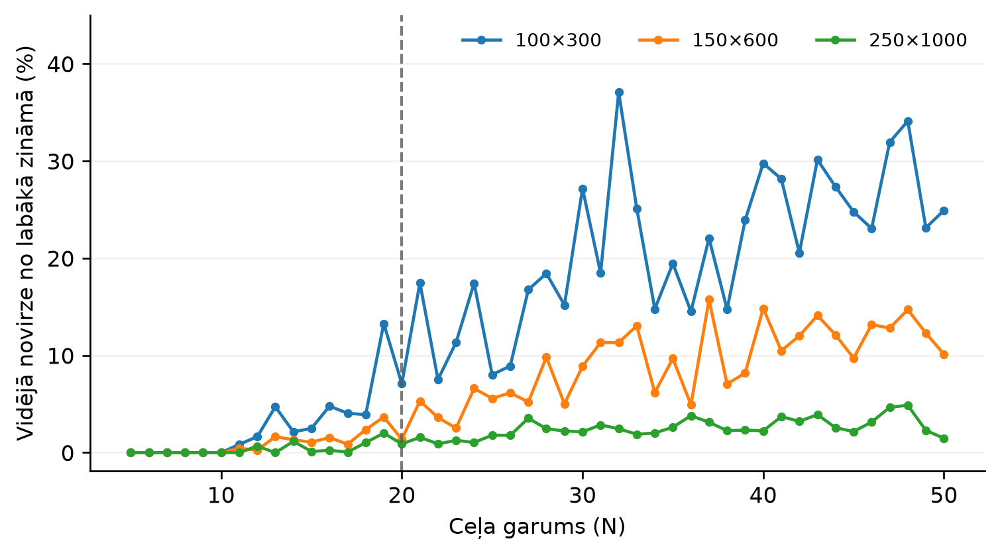

# DatZM014 : Praktiskā kombinatoriālā optimizācija MAZAIS praktiskais darbs



Lai redzētu šo vizualizāciju var izmantot

```
python game.py --example X
```
kur `X` ir ceļa garums (N), ja to neievada, tad tiek izmantota noklusējuma vērtība 40.

Pirms atrādīšanas, tā tiek apmācīta izmantojot `POPULATION_SIZE = 250` un `GA_STEPS = 1000`.

Savukārt, lai atkātotu dokumentā veikto eksperimentu rezultātus, var palaist vienkārši 
```
python game.py
```

un dažādu "konfigurāciju" rezultātu iegūšanai ir kodā jāpamaina POPULATION_SIZE un GA_STEPS.


